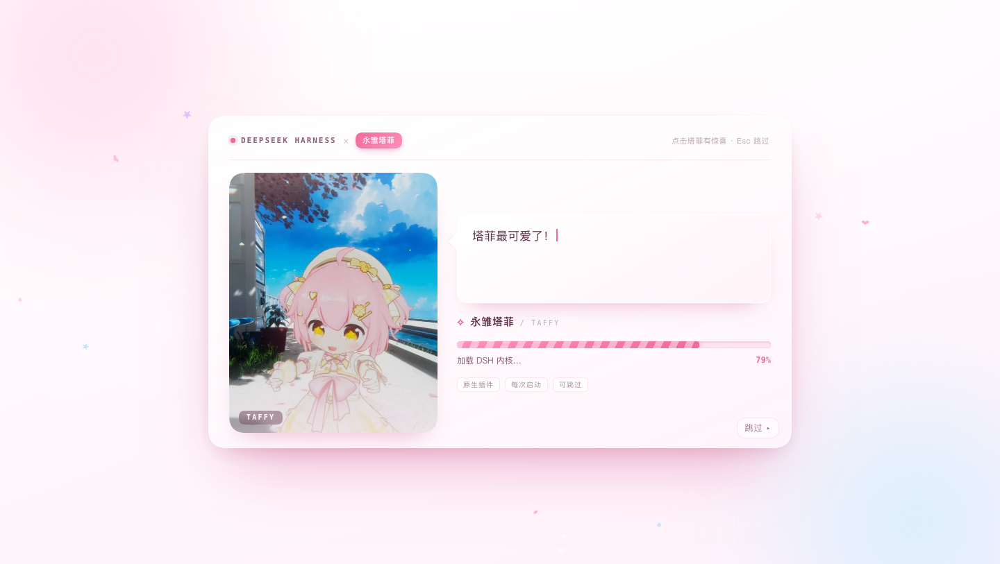

# Taffy Boot Animation for DeepSeek Harness

**中文** | [English](README.en.md)

A **[Yongchu Taffy](https://space.bilibili.com/)**-themed boot animation for the
DeepSeek Harness desktop app. Launch DSH from its own Dock icon and the animation
plays on the first frame of the GUI — no wrapper app, no shortcuts, no debug port.



Implemented as a native **Cordis plugin**: the host injects the splash into the
first `index.html` through `webServer.tapIndex`, with a client-side bundle as a
fallback. **No `app.asar` edits, no code-signing changes, no remote debugging.**

> Unofficial fan project. Not affiliated with DeepSeek or the Taffy team.
> Bundled demo artwork belongs to its respective owners — see [NOTICE.md](NOTICE.md).

---

## Features

- **Plays on original launch** — no wrapper app or launcher required
- **Dual rendering channels** — host injection + client bundle fallback
- **Image slideshow** — drop your own art into `backgrounds/`, cross-fades every 1.8 s,
  shuffled on every launch
- **Optional collages** — `make-collages.py` builds grid / triptych / polaroid / banner frames
- **Works without images** — falls back to an original SVG mascot
- **Easter eggs** — click for hearts and lines; idle lines; rapid-click reactions
- **Safe by construction** — hard 16 s timeout, reveals only after the GUI mounts
- **Fully reversible** — uninstall and the old splash config is restored

---

## Install

Requirements: macOS, DeepSeek Harness desktop `0.2.x`, Node.js ≥ 20.

```bash
git clone <your-repo-url> taffy-boot-dsh
cd taffy-boot-dsh

node scripts/build.mjs --pack
node scripts/install.mjs
```

Then **quit DSH completely (⌘Q) and reopen** it.

The installer adds the plugin with `dsh plugin --profile desktop add`, appends it to
`dsh.profile.bundles`, and disables and removes `dsh-startup-secret` from `dsh.profile.bundles` (so it cannot inject a second splash)
(backup: `~/.dsh/dsh-startup.json.taffy-bak`).

Uninstall:

```bash
node scripts/install.mjs --uninstall
```

---

## Images

This repository bundles **19 demo images** (15 originals + 4 collages); their rights
belong to the original owners — see [NOTICE.md](NOTICE.md). To use your own:

```
backgrounds/            # your images (git-ignored)
```

1. Add `.jpg/.png/.webp` files (portrait 4:5 or square works best)
2. Optional: `python3 scripts/make-collages.py`
3. `node scripts/build.mjs --pack && node scripts/install.mjs`
4. Quit and reopen DSH

---

## Customize

- Lines / timing: `DEFAULTS` at the top of `src/taffy-boot.js`
- Colors: `--tb-*` variables at the top of `src/taffy-boot.css`
- Slideshow interval: `swapMs` (default 1800)
- Live preview: `demo/boot-preview.html`

Rebuild and reinstall after changes.

---

## Config

`~/.dsh/taffy-boot.json`:

```json
{ "enabled": true, "tap": true, "client": true, "duration": 9000, "playOnce": true, "allowSkip": true }
```

`tap` / `client` toggle the two rendering channels; `enabled: false` disables the
animation without uninstalling.

---

## How it works

```
DSH launch → host assembles profile bundles
           → dsh-taffy-boot host side
             ├─ registers /dsh-taffy/splash.{css,js}, asset, config, beacon
             ├─ tapIndex(): injects <link>, veil, image list, deferred splash.js
             └─ client bundle: if the document was not injected
                (dsh-app:// direct), fetch config → load splash.js → render
                → after ~9 s and once the GUI is mounted → fade out and clean up
```

Diagnostics: `~/.dsh/taffy-boot.log` (`plugin ready`, `inject ok`, `beacon: client`).

---

## Development

```bash
node scripts/build.mjs         # src → lib, compress assets, write demo manifest
node scripts/build.mjs --pack  # also produce dist/*.tgz
node scripts/test.mjs          # offline assertions + local server + headless screenshot
```

---

## Security

No app bundle or signature changes, no API keys or sessions touched, no debug port.
See [SECURITY.md](SECURITY.md).

---

## License

MIT for the code. Bundled demo artwork is **not** covered by MIT and remains the
property of its respective owners; it will be removed on request. When no images are
provided, an original SVG mascot is shown instead.

---

## Credits

- [Fei-Away/Codex-Dream-Skin](https://github.com/Fei-Away/Codex-Dream-Skin) — injection boundary and theme engineering
- [fishcold789/Taffy-Codex-Theme-Studio](https://github.com/fishcold789/Taffy-Codex-Theme-Studio) — Taffy visual language
- [NativeDog1/dsh-boot-animation](https://github.com/NativeDog1/dsh-boot-animation) — DSH client-bundle plugin shape
